# QA Record

Every scenario below ran in the real Dev app (`Agent Session Manager (Dev)`) driven through its real UI by XCUITest, against a scratch git repository with a local bare `origin`. No application state was injected. The same ten scenarios ran twice: once on a Dev app built from the base commit `f805022` (before) and once on this branch (after). The raw `git worktree list`, `git branch`, and `du` output for each phase was captured by the test itself. Screenshots are in `qa-evidence/`.

## Reproduction: before and after

| # | Scenario | Before (base `f805022`) | After (this branch) |
| --- | --- | --- | --- |
| 1 | Control: clean worktree, close pane, Delete Worktree | Folder removed. Branch `track-r1-clean` left behind. | Folder removed. Branch removed. |
| 2 | One modified file, close pane, Delete Worktree | No message. Pane gone. Worktree and branch left on disk. | Worktree Has Unsaved Work dialog lists "1 modified file". Keep Worktree leaves everything. |
| 3 | Untracked file and a local commit | No message. Worktree and branch left on disk. | Dialog lists the untracked file and the commit not on any remote. |
| 4 | Tab close button | Tab gone, no prompt, worktree and branch left. | Close Tab With Worktrees dialog. Delete Worktrees removes folder and branch. |
| 5 | ⌘K | Tab gone, no prompt, worktree and branch left. | Same dialog. Folder and branch removed. |
| 6 | Delete This Tab menu item | Tab gone, no prompt, worktree and branch left. | Same dialog. Folder and branch removed. |
| 7 | Clean worktree with a 200 MB git-ignored `.build` folder | Folder removed (204,812 kB freed). Branch left behind. | Folder removed. Branch removed. |
| 8 | Process still writing in the folder | Folder removed. Branch left behind. | Process ended first, then the folder and branch were removed. No failure alert. |
| 9 | Shell pane open on the same checkout | Folder deleted under the open shell pane. Branch left behind. | Worktree kept. Notice names it and says "Another pane is still using it." |
| 10 | Detached HEAD with a commit on no remote | Folder removed with no warning. `git branch -a --contains <sha>` is empty, so the commit is unreachable. | Dialog lists "1 commit not on any remote on a detached HEAD". Keep Worktree leaves the folder. |

### Hypotheses from the proposal

- Cause 1, silent failed delete: confirmed by scenarios 2 and 3. The pane closes and the worktree stays with no message.
- Cause 2, tab close never cleans up: confirmed by scenarios 4, 5, and 6.
- Cause 3, branches never deleted: confirmed by every before run that removed a folder (1, 7, 8, 9), where the branch remained.
- (a) `git worktree remove` deletes ignored build folders: confirmed by scenario 7.
- (b) Removal races with a process still running in the folder: not reproduced. The folder was removed on the base build as well. The implementation still ends the pane's processes and waits, bounded to 2 seconds, before removal.
- (c) Removing under an open shell pane: confirmed by scenario 9 on the base build.
- (d) A clean detached HEAD with local-only commits is removed without warning: confirmed by scenario 10.

### Before

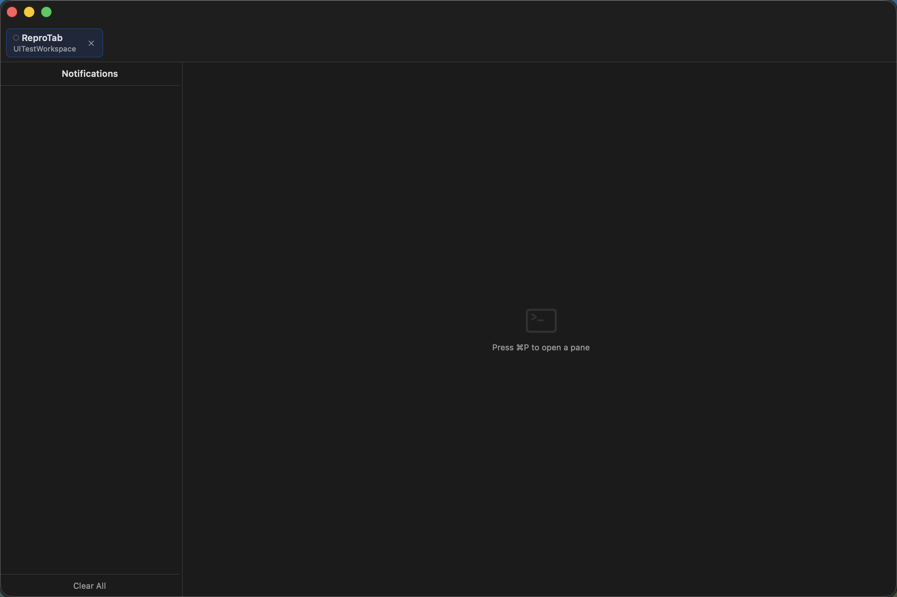

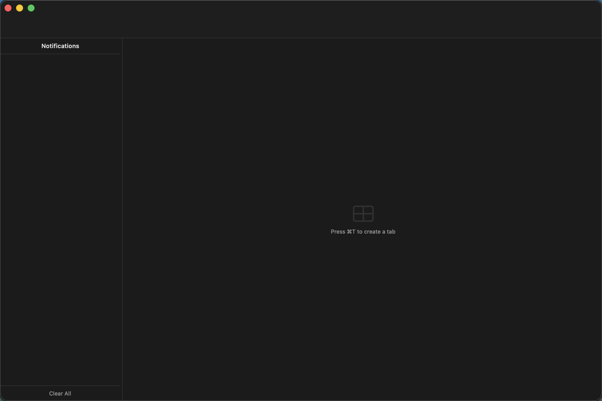

### After

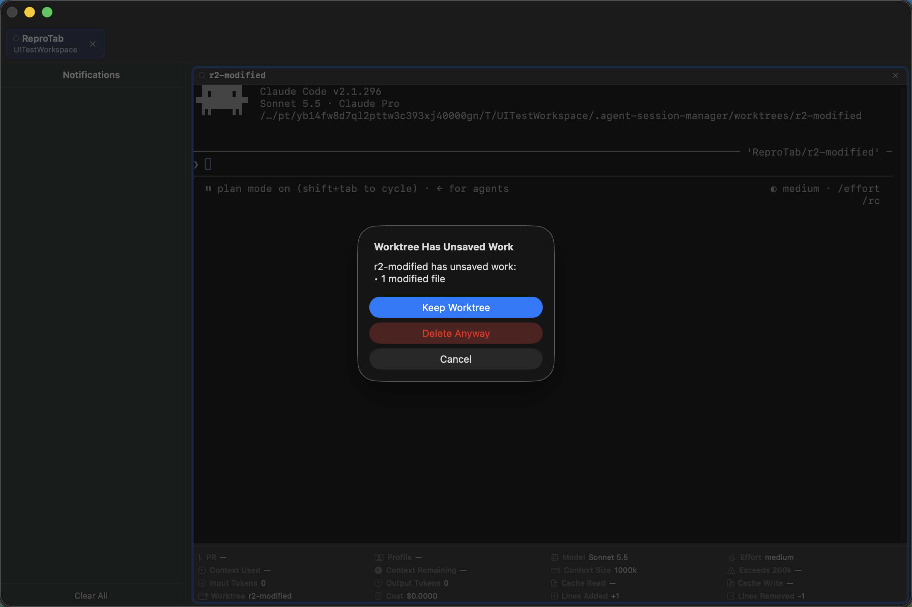

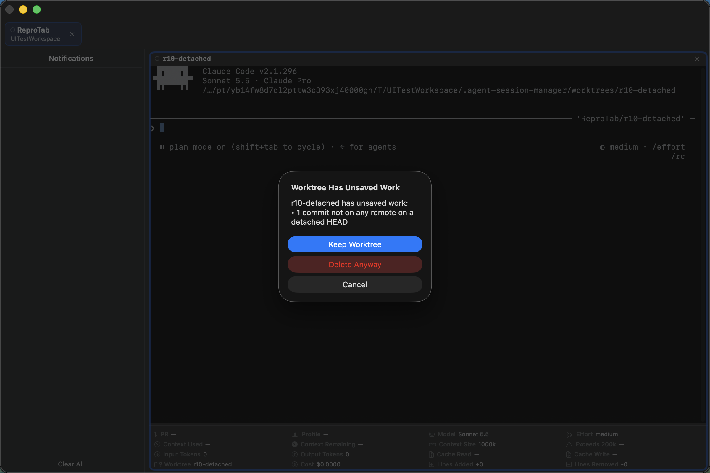

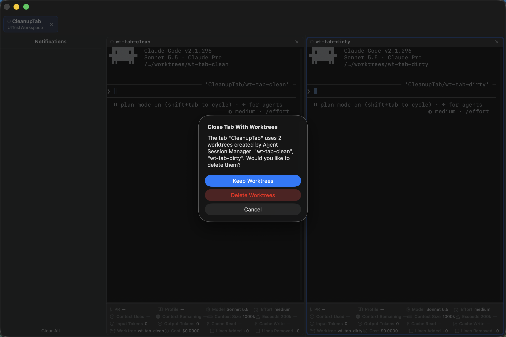

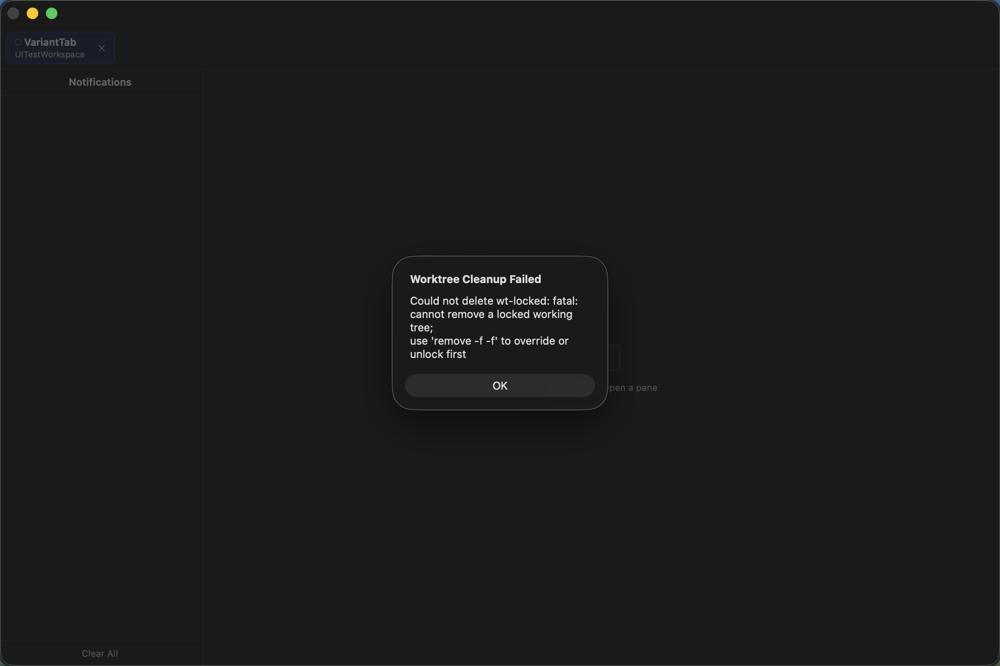

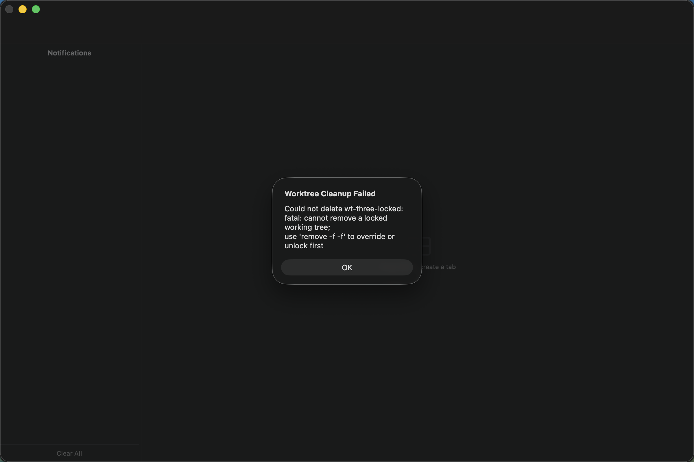

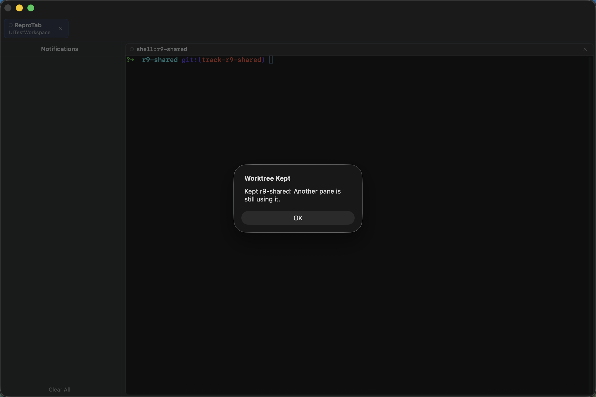

## Leftovers and launch cleanup

Dev UI flows seed real worktrees in a real repository, then launch the Dev app without `--uitesting-skip-restore` so the launch sweep runs after session restore.

- `stale-clean`, older than 24 hours with no unsaved work, was removed.
- `stale-dirty`, older than 24 hours with one untracked file, was kept.
- `fresh-clean`, changed within 24 hours, was kept.

The trace events written by the launch (`qa-evidence/launch-sweep-decisions.jsonl`) list each decision:

| Event | Worktree | Reason |
| --- | --- | --- |
| `worktree.leftover.removed` | `stale-clean` | |
| `worktree.leftover.skipped` | `stale-dirty` | It has unsaved work: 1 untracked file. |
| `worktree.leftover.skipped` | `fresh-clean` | It changed within the last 24 hours. |

Settings → Panes → Cleanup shows the Worktree Cleanup, Delete Branch With Worktree, and Clean Up Leftovers at Launch settings above the Leftover Worktrees list.

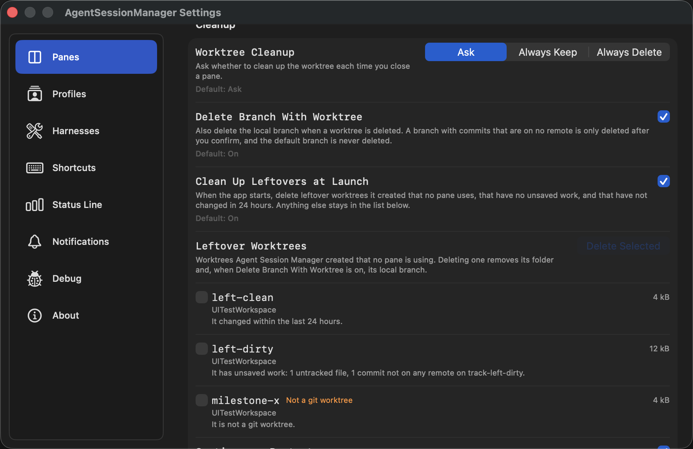

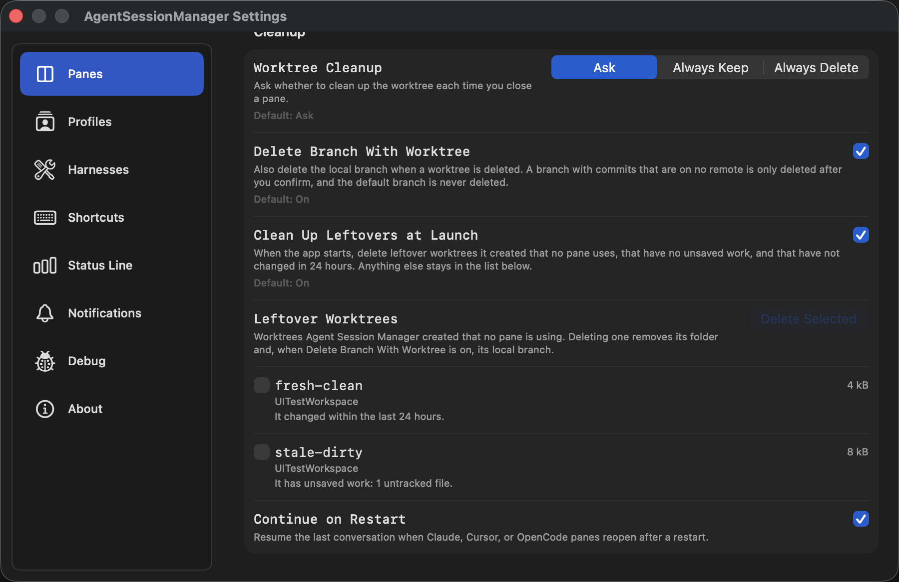

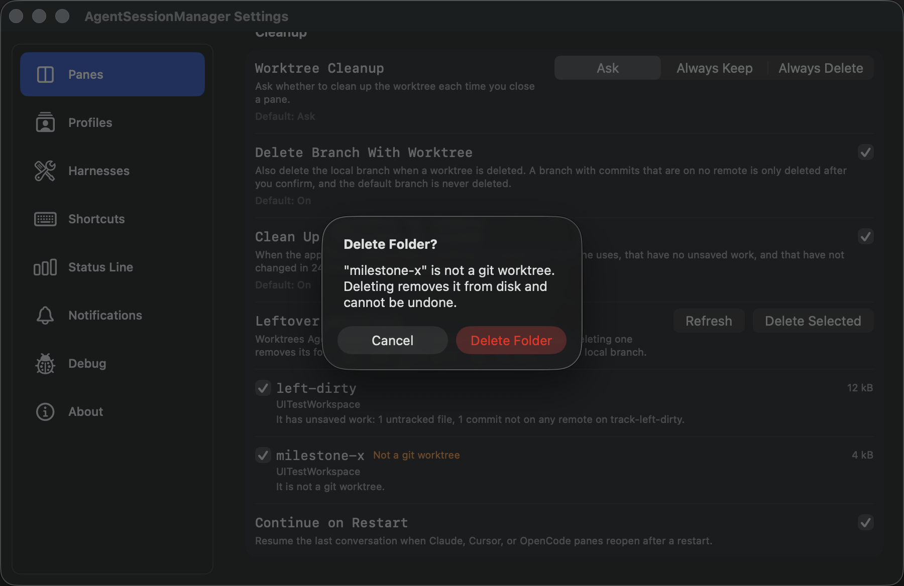

## Dev UI coverage by task

| Task | Dev UI flow |
| --- | --- |
| 2.1, 2.2, 2.3 | `WorktreeCleanupVariantsFlowTests`: modified file, detached HEAD, locked worktree failure alert, process still writing, shell pane in use, Keep Worktree and Delete Anyway. |
| 3.1, 3.2 | `WorktreeCleanupFlowTests` and `WorktreeCleanupVariantsFlowTests`: tab close button, ⌘K, Delete This Tab, Cancel, tab without managed worktrees, Always Keep, Always Delete, and the three-worktree partial result. |
| 4.3 | `LaunchCleanupFlowTests`: launch sweep with trace assertions. |
| 5.1, 5.2 | `WorktreeCleanupFlowTests`: leftovers list, delete clean entry, Delete Anyway for a dirty entry, unregistered folder confirmation, empty state. |
| 6.1, 6.2 | Ten repro scenarios above, run on the base build and on this branch. |

## Final checks

- `swift test` passed in the commit hook, and `make lint`, `make no-code-comments`, `make no-fixed-width-prose`, `make docs-check`, and `openspec validate fix-worktree-cleanup --strict` exited 0.
- `scripts/test-release-publishing.sh` passed with Homebrew Ruby first on `PATH`. It fails under the macOS system Ruby 2.6 on a key-parsing line unrelated to this change.
- A focused Dev UI run of `WorktreeCleanupFlowTests`, `WorktreeCleanupVariantsFlowTests`, and `LaunchCleanupFlowTests` executed 17 tests with 0 failures.

## Task 2.4: real agent-control call

Run in the Dev app built from commit 4c0f112. Claude Code in the `qa-2-4-target` pane, using the MCP server the Dev app injected into that pane, called `panes_delete` with `cleanup: "delete"` on the `qa-2-4-dirty` pane, whose worktree held one untracked file.

The result reported the pane deleted and the worktree `kept` with the reason "It has unsaved work: 1 untracked file." Afterwards the worktree folder, `unsaved.txt`, and the `qa-2-4-dirty` branch were all still present. The raw result and the on-disk listing are in `qa-evidence/agent-control-panes-delete-kept.txt`.

## Validation review fixes

The adversarial review found that removal failed whenever the calling task was cancelled, which silently defeated the rollback after a cancelled pane creation. Removal now runs outside the caller's cancellation, and a unit test cancels the calling task and still sees the worktree and branch removed. The review also found that the in-use check only looked at tabs with an identical directory. It now compares resolved checkout paths across every open pane.

The scope check found a **Refresh** button on the leftovers list that the spec does not describe. It was removed along with its documentation mentions, and the leftovers screenshots were recaptured from the Dev app without it. The three cleanup flow classes passed again afterwards, 17 tests with 0 failures.
